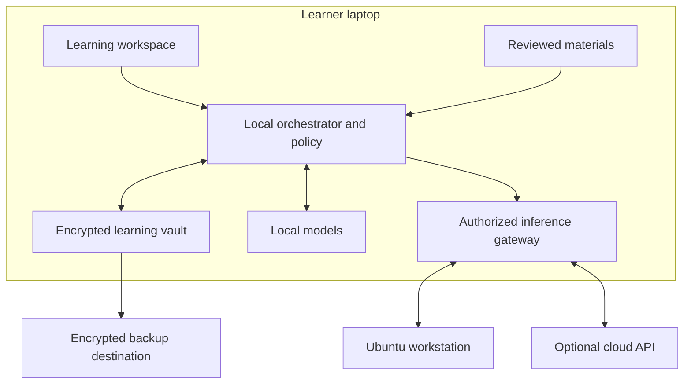

# Commonstar Learning OS

## Complete distribution specification · version 1.0

**Date:** 4 November 2026 · America/Chicago

**Project originator:** Hayden Lindley

**Purpose:** An open learning computer for Texas students, with intelligence and a portable learning record on the device.

**Document status:** Implementation specification. Model and upstream choices are researched; application, image, device, security, and educational acceptance require the evidence defined here. See `STATUS.md` for checks actually performed.

**Scope:** A Linux learner distribution, mandatory local intelligence, private learning memory, an Ubuntu workstation bridge and an optional cloud adapter. This is the current normative product specification.

The core decision is a Debian-based learner distribution with Gemma 4 E4B running locally, a private indexed learning vault, and an optional connection to a Gemma 4 31B worker on the owner's Ubuntu workstation. An OpenAI API adapter is part of the backend design and is disabled until configured. Authoritative memory never depends on any model vendor.

## 1. Identity and public purpose

**Product name:** Commonstar Learning OS. **Short name:** Commonstar. **Repository slug:** `commonstar-learning-os`. **Description:** “An open learning computer with private local memory and intelligence.”

The name connects a shared public resource with a Texas star without claiming governmental status. It is intended to be credible in a classroom, a school board agenda, and a technical repository. Preliminary exact-name searches did not identify an identical education-software product; this is not trademark clearance. Do not use state seals, agency logos, candidate identities, or endorsements without authorization.

Commonstar's public purpose is to help a learner understand more, organize their work, preserve useful continuity, and become more capable independently. Teachers and families remain visible participants. The product must be usable for an adult's own learning, a supervised school setting, and later other education systems through replaceable curriculum packs.

The initial real-data user is the project originator, using his own materials on a laptop and his Ubuntu workstation. The same architecture must support children, but an adult engineering demonstration does not establish a school's authorization or educational effectiveness.

## 2. Required outcome

These requirements define the complete product. Implementation milestones establish dependencies; they do not remove requirements from the requested vision.

| ID | Required behavior | Observable result |
| --- | --- | --- |
| R01 | Installable learner distribution | A versioned live USB image boots and installs onto a supported laptop; encrypted restart and recovery work |
| R02 | Full local intelligence | With internet and workstation disconnected, the installed model answers a new grounded question, explains, plans, and proposes organized records |
| R03 | Persistent learning memory | Saved sources, notes, goals, tasks, evidence and corrections survive application restart and device reboot |
| R04 | Local hybrid retrieval | Structured, lexical, semantic and relationship-based retrieval return attributable evidence within the active profile |
| R05 | Personal learning organizer | Imports become an inspectable library; accepted goals, plans and reminders remain usable offline |
| R06 | Workstation intelligence | An explicitly paired Ubuntu host answers through an authenticated private channel without taking custody of the vault |
| R07 | Optional frontier provider | A configured OpenAI adapter can execute the same normalized task contract, with explicit data and spending policy |
| R08 | Inspectable memory | The owner can see, correct, export and request deletion of what is remembered, including derived summaries |
| R09 | Recoverable backup | One selected destination stores versioned encrypted snapshots that restore onto a clean device |
| R10 | Provider independence | Replacing a model or provider preserves source material, identity, learning evidence and export readability |
| R11 | School deployment controls | A district can set allowed providers, content, retention, custody, updates and roles without receiving an automatic copy of every private interaction |
| R12 | Accessible bilingual foundation | English and Spanish interface/content paths, keyboard use, screen reader operation and accessible mathematics are tested |
| R13 | Honest computation states | Loading, indexing, slow inference, cancellation, offline operation, full storage and failed recovery preserve work and explain next steps |
| R14 | Publicly buildable system | Source, contracts, dependency identities, model provenance, build recipe, licenses and acceptance results are available |
| R15 | No student monetization | No advertising, sale of learner records, or shared-model training on private learning records by default |
| R16 | Future model expansion | New signed models, accelerators and modalities can be introduced without replacing the vault format |

## 3. Experience and principal journeys

### First start

The learner chooses language and accessibility settings, creates or unlocks a local profile, and sees the installed model and storage status. No commercial account is required. The setup explains who controls the device and recovery key. Personal mode starts with local inference and no remote destination. School mode imports a signed, approved policy with a named custodian.

The initial screen offers **Continue learning**, **Add materials**, **Plan my study**, and **Ask about my library**. A persistent, readable indicator says **This device**, **Your workstation**, or the approved cloud provider. It must describe the actual computation destination, not a marketing abstraction.

### An adult daily-learning session

1. Import an original PDF, Markdown document, EPUB, image, audio note, or selected folder. An HTML page or remote resource requires a deliberate fetch action.
2. Watch extraction and indexing progress. The imported original is preserved and locators remain linked to it.
3. Ask what matters for a current goal. The answer identifies the passages it used and separates source-based statements from general model knowledge.
4. Accept a study plan with local tasks and reminders. A proposed deadline is visibly a proposal until accepted or covered by a previously granted local scheduling rule.
5. Ask for an explanation or practice; save an insight or record an actual attempt.
6. Close the app, reboot, and continue with the relevant goal, sources and unfinished step.
7. Inspect and correct an erroneous remembered fact; subsequent answers and reminders use the corrected revision.
8. Pair the workstation when deeper assistance is wanted, inspect the outgoing context, and return to local mode without changing the record format.

### A supervised school session

The teacher selects an approved objective and content pack. The learner tries a task, receives a bounded hint or explanation, and then attempts a fresh problem independently. Evidence distinguishes hints from unaided success. The teacher can review an explicitly shared educational summary; full conversation monitoring is not the default architecture.

The first educational acceptance pack should cover ordinary Texas Grade 8 proportional and nonproportional linear relationships. Candidate mappings are TEKS 8.4(C) and 8.5(A), (B), (F), and (I), subject to current-standard and teacher review. Other subjects use the same content and evidence contracts. This starter pack is a verification scope, not the product's subject ceiling. [S20]

### Interface structure

| Area | Purpose | Required states |
| --- | --- | --- |
| Today | Resume a goal, upcoming work, a useful next action | Empty, saved plan, overdue task, no active course |
| Library | Originals, extracted sources, annotations and collections | Importing, indexed, partially extracted, unsupported, corrected source |
| Learn | Reading, tutoring, practice and independent attempts | Local, remote, thinking, interrupted, invalid answer, insufficient evidence |
| Projects | Goals, milestones, tasks and learning artifacts | Proposed, accepted, active, blocked, completed, archived |
| Memory | What is remembered, its source and current revision | Observed, proposed, corrected, disputed, expired, deletion pending |
| Privacy & Recovery | Destinations, receipts, keys, export and backup | Unconfigured, healthy, overdue backup, wrong key, corrupt snapshot |

Use a calm desktop with a persistent workspace, readable typography, restrained motion and a small number of primary actions. Do not require chat to find a file, inspect a deadline, change a provider, or recover work. Include keyboard shortcuts without making them the only route. Support 200% text zoom, narrow windows, high contrast, reduced motion, RTL-ready layouts, captions/transcripts and math that exposes semantic text. WCAG 2.2 AA is the web-interface target; native screen-reader behavior and actual mathematics remain separate checks. [S21]

## 4. System architecture

The vault is authoritative. Models are replaceable computation workers. The model may propose a note, explanation, practice item or plan; trusted local code validates and commits any durable change. Security, identity, arithmetic checks, permissions and transactions do not depend on a model following instructions.

### Selected implementation stack

| Layer | Selection | Ownership and boundary |
| --- | --- | --- |
| Learner OS | Debian 13 Trixie; initial researched baseline 13.7 | Stock distribution packages and security updates |
| Desktop | KDE Plasma / Wayland | Simple learner defaults, ordinary desktop retained |
| Application | Tauri 2 with React and TypeScript | Bundled interface, tightly scoped native IPC; no remote app code |
| Trusted services | Rust vault, orchestrator, policy and job services | One active profile; transactional state and bounded capabilities |
| Private database | SQLCipher with SQLite FTS5 | Records, chunks, vectors, revisions, relationships and receipts |
| Semantic index | `sqlite-vec` inside the encrypted database | Pinned extension; SQLCipher compatibility is a release gate |
| Text generation and embeddings | Pinned llama.cpp runtime | Unprivileged, model-only access, no arbitrary tools or egress |
| File extraction | Sandboxed workers using maintained parsers, Poppler/Tesseract where appropriate | Selected files only, no document scripts or remote resources |
| Attachment encryption | Maintained libsodium authenticated-stream primitives | Per-profile data keys, no custom cryptographic construction |
| Backup | Restic over already protected vault snapshots | Separate repository credentials and recovery policy |
| Personal host transport | OpenSSH local forwarding with pinned host identity | Inference endpoint only, no remote shell grant |
| Optional cloud | OpenAI Responses adapter | Disabled initially, explicit model/account/policy configuration |

Tauri supplies native application packaging and capability controls; it does not itself prove a secure application. SQLite extensions, parsers and FFI boundaries require dependency pinning and tests. [S1–S5, S22–S24]

### Process access contract

- The UI receives approved views and command results. It never receives raw vault keys, model API secrets or unrestricted filesystem access.
- The vault service alone opens the active private database and attachment keys. The orchestrator receives records through a scoped API.
- Generation and embedding workers receive bounded input and read-only model files. They cannot read the vault directory, arbitrary home files or external network destinations. OS controls deny external outbound traffic while retaining only authenticated private Unix/loopback IPC needed by the orchestrator. A loopback bind or runtime `--offline` flag alone does not implement this sandbox; private-data startup fails if the required isolation is unavailable.
- Extraction workers receive handles for selected inputs and write quarantined output. Archive path traversal, oversized decompression, document scripts and remote references are rejected.
- The inference gateway alone can contact a paired workstation or approved cloud endpoint. It writes a minimized local receipt.
- Backup and update workers have separate credentials and permissions. Updating a model cannot authorize access to student history.

Use per-user Unix-domain sockets with peer-credential checks for native services. Where HTTP is used for a test client, bind to loopback, require an unpredictable session credential, enforce Host/Origin and CSRF protections, and reject DNS rebinding. A localhost address is not authentication. Inference secrets remain backend-only.

## 5. Distribution, installation and updates

### Distribution decision

Use **Debian 13.7 Trixie as the researched image baseline**, tracking supported Trixie security updates. Debian's release information provides amd64 and arm64 architecture support; that does not prove a particular Chromebook's hardware support. Official Debian live-image tooling supports a reproducible build recipe and Calamares installation. [S1–S2]

There are three delivery forms with the same learning contract:

1. **Full learner ISO:** amd64 UEFI live USB, installer, model, offline help and starter content. After installation it works without network access.
2. **Existing-Linux packages:** the same companion services on supported Debian/Ubuntu. This is the first two-machine test path on the owner's existing equipment.
3. **ChromeOS Linux package:** the application inside an administrator-enabled Linux environment on specifically tested Chromebooks. It is not a replacement ChromeOS image.

Native arm64 packages are required. Bootable arm64 media require a named hardware/firmware target and separate acceptance. Managed ChromeOS commonly requires an administrator to enable Linux VMs; current Google policy documents managed Linux VMs as blocked by default. A laptop behaving like a Chromebook is a valid initial experience test, and remains distinct from managed ChromeOS certification. [S6]

### Installation contract

Use GPT with an EFI System Partition, separate `/boot`, and LUKS2-encrypted ext4 root/data. Default to zram; disable hibernation until encrypted resume is tested. Store all private data, swap-backed private state and private temporary files inside the protected boundary. Never place a vault or disk-unlock key into unencrypted boot files.

The installer displays the selected disk, its capacity and the destructive changes before formatting. The default first experiment uses a spare device or expendable VM. It must test keyboard, pointing device, Wi-Fi, graphics, sound, suspend, resume, clock, encryption unlock and a full restart.

Use upstream signed boot components. Separate `/boot` avoids assuming the bootloader can unlock every LUKS2 configuration, but does not prove full authentication of all early-boot files. A lost powered-off device, an unlocked administrator session and physical boot tampering are different threat cases.

A live session is visibly temporary. Durable use requires an installed encrypted system or an explicitly configured encrypted persistent vault. Important learner work must never appear safely saved when it exists only in a disposable live session.

### Update and recovery contract

Use signed APT repositories for initial OS/application updates. Keep OS maintenance separate from lessons; do not force a restart during learning. Preserve the previous kernel and a compatible previous application package. Migrations run transactionally after a consistent safety snapshot. A downgraded application must refuse an incompatible vault schema rather than corrupt it.

This version specifies conventional updates plus verified recovery. Atomic A/B system images and Btrfs rollback remain an architectural extension, not an unimplemented promise. OS recovery must never silently roll the learner's recent data back. A recovery USB and clean-device vault restore are mandatory release gates.

Each image identifies source commit, build environment, package versions, model hashes, notices, SBOM, checksum and maintainer signature. No unsigned checksum is described as authentication. Reproducibility requires two independent builds and comparison; a checked-in recipe alone is not evidence of reproducibility.

The detailed packaging, boot and release contract is in `docs/INSTALLATION_AND_RELEASE.md` and `distro/`.

## 6. Firm intelligence choices

### Selected models

| Role | Exact model package | Parameter accounting | Text weight size | Initial execution budget |
| --- | --- | --- | --- | --- |
| **Standard learner** | `google/gemma-4-E4B-it-qat-q4_0-gguf` | 4.5B effective; 8B including embeddings | 5,154,941,280 bytes | 8,192-token context; one generation |
| **Compact learner** | `mistralai/Ministral-3-3B-Instruct-2512-GGUF`, Q4_K_M | 3.4B text plus optional 0.4B vision encoder | 2,147,023,008 bytes | 8,192-token context; one generation |
| **Ubuntu workstation** | `google/gemma-4-31B-it-qat-q4_0-gguf` | 30.7B in the architecture table | 17,651,001,568 bytes | 16,384-token default; 32,768 evaluated profile |
| **Workstation alternative** | `google/gemma-4-26B-A4B-it-qat-q4_0-gguf` | 25.2B total; 3.8B active | 14,439,363,584 bytes | Evaluate latency and quality before selection |
| **Local semantic retrieval** | `ggml-org/embeddinggemma-2-GGUF`, BF16 | Google's 270M text backbone | 557,950,176 bytes | 768-dimensional normalized vectors |

All listed model packages carry Apache-2.0 licenses in the checked sources. Full revisions, filenames and publisher-reported hashes are in `models/catalog.json`. These metadata are not independently verified downloads or performance measurements. [S7–S12]

**Decision:** Gemma 4 E4B is the standard local model. The 3B profile is a complete smaller installation, not a thin client. Neither one is being claimed to have proven superior educational outcomes. The first release evaluates the exact packaged quantization on the same tasks before certifying the profile.

“E4B” is an effective-parameter designation; it must not be sold as an eight-billion-weight model fitting the memory of an ordinary four-billion-weight model. File size is not peak process RAM. Multimodal projectors, caches, work buffers, operating system, UI and private indexes add memory and storage. The 26B MoE alternative still stores its full weights.

### Forward-looking capacity

Plan around a 16 GB learner reference device for the full profile, an 8 GB reference for the compact profile, and a 32–64 GB CPU-memory workstation experiment for the larger model. These are **planning envelopes, not measured minimums or purchase advice**. Inspect existing equipment before recommending purchases. CPU-only execution is valid when the user accepts latency; supported GPU acceleration improves the experience after testing.

The software must not reject otherwise capable hardware simply because it falls below an unmeasured marketing tier. It reports detected resources, offers measured profiles, reduces concurrent work and supports slower background jobs. Swapping cannot be represented as a universal substitute for RAM, and a large hard drive does not establish acceptable latency.

The full archive is disk-backed and indexed. A model sees a relevant working set, not the learner's entire life on every request. More powerful hardware increases inference capacity, context and modalities without replacing the record system. No prediction about future hardware prices is a release dependency.

### Local runtime contract

Pin a reviewed llama.cpp revision and compiled backends. The research baseline is recorded separately from a model-tested release. Upstream command names and defaults have changed, so launch through a product wrapper whose flags are validated against the shipped executable's help and integration tests. [S3]

Explicitly set loopback address, port, context, output limit, concurrency, cache settings and authentication. Start with one active generation, no extra RAM prompt cache, no persisted conversation/slot cache and no runtime web UI. Disable built-in agents, shell/file tools, automatic public tunnels, MCP proxies, model-download routes and mutable global settings. A generic OpenAI-compatible transport does not imply OpenAI hosting.

For local tutoring, default to a bounded answer and an explicit **Think longer** action. Read, type, save and cancel remain responsive while generation runs. Show elapsed time and actual stage; never fabricate a progress percentage for unknown model completion time. Interrupted partial text does not automatically become a memory fact.

EmbeddingGemma 2 uses 768-dimensional L2-normalized vectors and matched query/document templates. Use BF16/F32-compatible execution; the upstream card warns against FP16 activations. Startup checks require finite values, correct dimensions, nonzero norm and expected fixture rankings. Index work pauses or yields during interactive generation. FTS5 and structured search remain available if embeddings are unavailable. [S11–S12]

### Modalities

The design supports text, document images, photographs of work, audio input and spoken output. Enable a modality only after its exact model, runtime, accessibility and privacy path passes acceptance. The selected Gemma E4B profile supports native audio input; the selected Gemma 31B and 26B profiles do not have a native audio encoder and require a separately validated local transcription path for spoken input. Native audio input does not imply native speech output; text-to-speech requires a separately licensed local speech engine and voice pack. Microphone and camera access are explicit and visibly active. No continuous ambient recording is required.

### Texas deployment consideration

Texas DIR's published list names Alibaba, BAAI and affiliates among prohibited technologies/developers for the specified state contexts. This creates a practical institutional-review issue for Qwen and BAAI embedding defaults. Commonstar selects other default packages. Applicability to a particular district, hardware owner and downloaded weights must be reviewed; this document does not assert that every local Qwen deployment in every ISD is unlawful. An election result does not itself change an existing policy. [S13]

## 7. The learning vault

### Storage and ownership

One active profile has one authoritative writing device and a unique encryption boundary. Workstation inference does not create a second writer. A school device uses separate OS accounts and per-profile keys; a visual account selector over a globally unlocked database is insufficient.

Suggested installed paths are `$XDG_DATA_HOME/commonstar/vaults/<opaque-id>/` for protected private records and `/var/lib/commonstar/models/` for read-only shared public models. Private caches stay inside the vault boundary. Logs omit raw prompts and records. The application repository is never a vault location.

Use SQLCipher for private records and derived indexes, with encrypted journals/WAL and memory-only temporary-store settings. Encrypt imported attachments, thumbnails, OCR text and private exports too. Full-disk encryption protects additional system copies, while a separate profile key supports portable encrypted backup and profile locking. [S4]

Use maintained libsodium authenticated-stream encryption for attachment payloads and maintained password-hashing/key-wrapping primitives. Random keys, nonces, authenticated metadata and format versioning are mandatory. A passphrase wraps the profile key; it is not used directly as a database key. Device keyring integration is optional convenience, not the only recovery route. Implemented cryptography requires review and test vectors. [S23–S24]

### Logical records

| Class | Durable meaning | Important rule |
| --- | --- | --- |
| Artifact | Original learning material or learner-created work | Preserve hash, origin, rights, edition, extraction version and locators |
| Note | Intentionally saved learning insight or annotation | Preserve source references and whether the text is user-authored or model-proposed |
| Learning event | What was attempted and observed | Distinguish independent, hinted, example-seen and unknown assistance |
| Learning state | Current evidence-based estimate of a skill | Versioned method and supporting events; revisable, never a permanent label |
| Explicit fact/preference | A sourced, scoped statement | Effective dates and superseded revision; no inferred diagnosis |
| Goal/project | An accepted learning objective and its materials | Track milestones and linked evidence |
| Task/plan | Proposed or accepted work with time zone and dependencies | Proposed schedule is not accepted schedule |
| Continuity | Dated current goal, unfinished step and bounded summary | Preserve uncertainty and evidence links |
| Policy/permission | Who may do what with which data and destination | Never writable by the model |
| Receipt | Minimal record of operation, scope, destination and outcome | No general log of every sensitive prompt |
| Correction/deletion | Repair, supersession, purge state and retention exception | Invalidate all dependent representations |

An accepted study plan is represented by a goal and its committed task records, created atomically. Its API plan identity is the goal record ID; there is no separate model-invented plan record. Tasks store dependency references to existing tasks in the same profile. A model's plan uses request-scoped step labels; the service validates the dependency graph and assigns stable task IDs at acceptance. Unknown references and cycles are rejected, and cancelled/retried acceptance cannot create duplicate tasks. Activation validates the expected goal revision and a service-issued dependency snapshot covering the included task identities, revisions and edges; a changed task graph requires a fresh preview.

The normative schema envelope includes schema version, opaque record/profile identity, revision, created/observed/effective times, provenance, review state, retention class and typed payload. Unknown model-write fields are rejected. The service fills identity and authority; a provider response cannot assign itself a teacher signature or permission grant. See `contracts/` and synthetic `examples/`.

### Temporal and evidence semantics

“Friday” is resolved against the original statement's time zone and date, and confirmed if ambiguous. Current course enrollment is separate from an old course archive. Recency alone cannot override an authoritative current source. Contradictory notes are marked as unresolved until a justified update establishes the current fact.

A successful hinted answer is useful evidence but is not independent mastery. Estimates link to actual attempts and the scoring method. Do not persist speculative intelligence, disability, personality, politics, religion or fixed learning-style labels. Explicitly authorized accommodations can be restricted sourced records; the tutor does not diagnose their cause.

## 8. Retrieval and memory evolution

### Retrieval pipeline

1. Trusted code resolves the unlocked profile, permitted purpose, record classes and effective-time scope.
2. Structured queries retrieve current goals, deadlines, explicit preferences and relevant skill evidence.
3. FTS5 and local embeddings retrieve candidate passages inside that scope.
4. A versioned rank-fusion step combines candidates; ordinary relationship tables expand relevant document/skill/prerequisite links by at most two bounded hops.
5. Exclude deleted, superseded, expired or unauthorized material. Preserve unresolved contradictions in the result.
6. Assemble a token-budgeted evidence bundle with source locators and dates.
7. Generate an explanation, action proposal or explicit unknown. Validate source labels and task-specific results before committing anything.

Initial tuning values are paragraph-aware chunks targeting 512 tokens with up to 64 tokens of overlap, 24 lexical and 24 semantic candidates, reciprocal-rank fusion with a constant of 60, and a final context selected by relevance and source diversity. Tables, equations and code blocks must not be split in ways that destroy meaning. These are tunable design defaults, not measured optimal parameters.

The generation context budget reserves space for policy, question and output before allocating evidence. When the archive grows, search and summarization manage it; the product never truncates or deletes original history merely to fit a prompt. Users can open the full original through a citation.

`sqlite-vec` is the selected native vector extension. Store its private tables inside SQLCipher and verify that no external plaintext backing files appear. Queries prefilter authorized scope before returning candidates to any model. Index version includes model revision, quantization, dimensions, template, chunking and normalization. An incompatible version forces reindexing from authoritative sources; mixed-vector comparisons are rejected. [S5]

### Consolidation

A local background job may propose summaries, deduplication and relationship links. It runs within power, thermal and disk budgets and yields to interactive work. It cannot change permissions, silently erase sources or strengthen a source's claim. Summaries carry evidence references, dates and review state. Correction invalidates summaries, recommendations, chunk text and embeddings downstream.

LongMemEval's extraction, cross-session, temporal, update and abstention categories inform engineering tests. They are not a substitute for evaluating learning outcomes. The architecture is an evidence-based combination of records and retrieval, not a claim that one fashionable memory library solves every problem. [S14]

## 9. Local orchestration and tools

The orchestrator is a durable job engine. Jobs have `queued`, `loading`, `running`, `awaiting_input`, `completed`, `cancelled` and `failed` states; transitions, cancellation tokens and retry/idempotency are persistent. A crash resumes a recoverable job or reports a precise failure. A half-completed generation cannot commit half a record.

Allowed model-facing operations are bounded application tools: search approved memory, read an identified source, propose a note, propose a plan, propose practice, request an answer check, propose a learning-state update, and ask for missing information. Tools use opaque request-scoped references, bounded result limits and closed schemas.

The model has no arbitrary shell, SQL, home-directory search, email sending, public publishing or administrative OS authority. Adult extensions can add narrowly scoped capabilities after an explicit configuration step. A document's instructions cannot grant a capability. Model confidence never bypasses a permission check.

Ordinary editing does not require inference. The learner can directly save a note and edit an authorized task's title, deadline, time zone or status through typed native/API commands. Trusted code constructs the record envelope, user-authored provenance and revision. These commands do not accept caller-supplied authority, permissions, official grades or an arbitrary memory-record replacement. A user-confirmed deadline is distinct from a model-proposed deadline awaiting acceptance.

### Commit policy

- Observed task events and explicitly saved user content may be committed under the active profile's previously accepted recording policy.
- A model-extracted fact must reference the actual statement and be marked proposed until the relevant policy or human acceptance permits it.
- Plans, deadlines and file organization changes remain proposals unless covered by a specific local automation grant.
- Teacher approval, official grades, accommodations, custody and provider permissions require the designated authority.
- Every mutation validates schema, profile scope, provenance, expected revision, idempotency and retention policy in one transaction.

External calendars, school information systems and shared dashboards are separate connectors with explicit additional data flows. Local study reminders and exports work without them. Optional local MCP interoperability exposes the same bounded tools to an approved local client; it does not expose a public vault endpoint or replace authorization.

## 10. Provider-independent inference contract

The provider boundary is a normalized context capsule and response. It carries purpose, bounded input, request-scoped source excerpts, minimal learning context, required output schema and execution limits. It excludes local profile IDs, school IDs, keys, unrelated history and full-vault search access.

The response contains answer text, existing source labels, proposed practice and typed memory/plan proposals. It cannot return an executable administrative command. The local service checks citations, schema and policy; a provider cannot create authority by returning an `approved` field. Models use request-scoped `S1` source labels, `E1` evidence labels, `T1` existing-task labels and the literal `current` for the current goal. The service privately resolves those labels to stable record IDs before constructing an authoritative record. Correlation IDs identify requests or proposals, never the learner.

| Route | Default state | What leaves the learner laptop | What remains authoritative |
| --- | --- | --- | --- |
| This device | Enabled after model installation | Nothing for inference | All learner records and decisions |
| Your workstation | Disabled until paired; can be selected as preferred during pairing | Approved context capsule over private authenticated transport | Identity, retrieval, permissions, writes and history |
| OpenAI | Disabled until configured and policy-approved | Explicitly allowed minimized context | Same local authority |
| Backup destination | Disabled until owner/custodian configures recovery | Authenticated encrypted snapshot objects and operational metadata | Local active vault |

A small pseudonymous capsule can still contain identifying information. “Memory is local” does not mean remote personalized inference processes no personal data. Strict on-device mode is the stronger privacy option. No timeout, outage or slow generation silently activates a remote or paid provider.

The capsule field `requested_data_policy.payload_logging: false` prohibits Commonstar/application payload logging. It is not a claim that an external provider has no abuse-monitoring retention. Provider-native retention is governed by the explicitly accepted provider profile and actual endpoint controls. If the active learner or school policy requires no provider-side payload retention, the gateway must reject a provider/feature combination that cannot meet it; the JSON request does not override the provider's behavior.

### Workstation backend

Run the selected model on the owner's existing Ubuntu system; current upstream Ubuntu LTS is 26.04.1, but inspect the actual installed version and hardware before selecting packages. No operating-system replacement is required for the host. [S25]

For the personal test, bind inference to workstation loopback and use a pinned-host-key SSH tunnel. The dedicated account permits forwarding only to the model endpoint and denies shell/subsystem/TTY/agent/X11 access. Verify effective OpenSSH configuration and negative tests. An application credential and route allowlist provide an additional boundary. [S26]

Disable payload logging, persistent chats, saved KV/slot state, core dumps and plaintext swap. The host sees selected plaintext during inference, and its administrator can inspect a running process. No claim of cryptographic proof of host erasure is made. After the test, inspect logs, temporary files, persistence and restart state with seeded canaries.

A later district host may replace the SSH transport with a mutually authenticated TLS gateway, per-device credentials, queue/admission control and policy separation. The protocol and custody boundary remain unchanged. There is no need to make the homeowner's workstation a public internet service.

### OpenAI backend readiness

Implement an adapter behind the same trait/interface: capability discovery, request validation, request translation, streaming/cancellation, structured response normalization, usage accounting and error classification. Select a supported model ID at configuration time after checking account availability; do not hardcode a fictional entitlement.

Use the supported API rather than browser-automating ChatGPT. Default to locally assembled requests, `store: false`, no hosted conversation memory, no hosted vector store, no uploaded lifetime archive and no background request mode unless its data controls are separately accepted. Endpoint-specific controls must be verified at activation. `store: false` is not approved Zero Data Retention. Ordinary logging/feature exceptions and under-13 requirements need current review. [S15–S17]

Adult personal mode can use an owner's credential in a protected secret store and a deliberate budget. A district-wide key must never be shipped in a client. School use requires an approved authorization route or credential gateway; any gateway handling content is an additional processor. Unconfigured credentials produce a complete local experience, not a broken sign-in screen.

No Anthropic integration is included in the required implementation. The common contract remains extensible without embedding personal opinions about vendors in public documentation.

## 11. API, migrations and interoperability

The trusted local API is versioned under `/v1`. Ordinary operations use the authenticated session's profile, not a caller-selected global student ID. Native IPC implements the same operation contracts as any loopback development API. A clean device can establish a separate recovery-scoped session through the trusted native recovery flow, bound to the OS user and a verified recovery grant. That session may only restore into isolated new-profile storage and inspect, stream or cancel its own restore job; it grants no ordinary record, search, inference or existing-profile access. Successful validation and deliberate activation require a fresh ordinary session before normal use.

| Operation | Contract |
| --- | --- |
| Import | A selected file handle or verified content-pack reference creates a cancellable extraction/indexing job |
| Search | Purpose, query and allowed filters return current attributable evidence |
| Turn | User request, goal and selected route create a streaming job |
| Proposal | Typed output is validated; acceptance is explicit where required |
| User-authored note | A restricted note payload creates a record with a service-assigned envelope and user-authored provenance; no model is required |
| Task editing | Typed, authorized title/deadline/time-zone/status edits validate the expected revision without requiring inference |
| Record correction | Expected revision and authorized correction invalidate dependent representations |
| Deletion | Authorized scope yields active purge, backup handling and any retention exception |
| Plan preview/activation | Read-only preview issues a snapshot scoped to the goal record ID; expected goal revision and that task dependency snapshot must match before activating reminders |
| Privacy receipts | Owner can inspect destination, purpose, selected scope and policy revision |
| Backup/restore | Snapshot identity, integrity and progress are explicit; restore activates only after validation |
| Export | Audience, data selection, format and encryption are previewed before creating another copy |
| Provider pairing | Endpoint identity, credentials, capabilities and policy are bound together |

All write requests carry an idempotency key; existing-record mutations also carry expected revision. Define stable error categories: invalid input, denied scope, stale revision, missing evidence, unsupported capability, locked vault, unavailable model, invalid provider output, budget exhausted, insufficient storage and integrity failure. Errors preserve recoverable state and must not include raw secrets.

The self-contained OpenAPI 3.1 document in `api/openapi.json` specifies closed request/response shapes and embeds the seven versioned contracts. Native capability grants authorize file selection, recovery, disclosure and pairing without placing raw paths or secrets in request JSON. Its generated contract and validation checks are described in `api/README.md`.

Version schemas independently of model packages. A migration declares from/to versions, transaction behavior, minimum compatible app and rollback/restore requirement. Exports include JSON/JSONL, original files, provenance, schema definitions and a human-readable index. Import/export must work without a vendor account. Learner data is not licensed under the source repository's software license.

## 12. Content, curriculum and import rights

Separate three content classes: public reviewed curriculum, personally imported materials, and generated working material. Each artifact records rights status and permitted use. Possession of a textbook PDF is not a license to redistribute it in the public distro or use it for model training.

A content-pack manifest specifies package/version, authors, license, exact file hashes, standards mappings, prerequisite links, exercises, answer-check methods, accessibility assets, reviewer identity/state and supported languages. Reject unsigned/untrusted packs according to the active policy. A developer-created fixture is marked synthetic or unreviewed; it cannot assert teacher approval.

Build the first pack from original material or explicitly compatible resources. Evaluate maintained offline ecosystems such as Kolibri for content/workflow reuse, while preserving Commonstar's custody rule; an ecosystem's default server synchronization is not automatically acceptable.

No fine-tuning is required to begin. Retrieval attaches a dated, replaceable body of knowledge to an open model. A later separately governed fine-tuning workflow uses deliberately licensed, reviewed material; private student records never become shared training data by default. A model update must not erase or reinterpret old learning events as if the new model observed them.

Imported web pages are data, not executable instructions. PDF/EPUB/Office extraction is sandboxed with size, decompression, timeout and resource limits. Store page/section/timestamp locators and extraction confidence. OCR errors are visible and correctable. When extraction fails, retain the original, report the failure and offer a supported alternative.

## 13. Privacy, backup and recovery

### Data protection

The application promises local authoritative memory and explicit off-device operations. It does not promise that encryption protects an unlocked device from its administrator, that a remote host can never inspect its own memory, or that a revoked offline clone has been remotely erased.

Secrets and keys stay out of Git, URLs, analytics, screenshots and diagnostics. Telemetry is off by default. Optional diagnostic export shows its contents and removes records, payloads and credentials. General application logs contain event codes and non-sensitive operational measures, not full prompts.

### Backup destination and key custody

One backup destination contains versioned encrypted snapshots. It is not an active cloud memory database. The backup provider sees ciphertext and operational metadata; it does not receive the decryption secret. Personal mode uses an owner-held recovery package. School mode identifies any recovery custodian and makes clear that possession of the recovery key gives decryption capability.

Three secrets have distinct jobs: **destination credentials** authorize access to backup storage; the **restic repository secret** unlocks the backup repository; the **profile recovery secret** unwraps the random profile root key used for database and attachment encryption. Do not reuse one as another. Ordinary device unlock uses a separate passphrase-derived wrapping key with a random salt and calibrated Argon2id parameters; domain-separated subkeys serve database and attachment purposes.

The recovery design must avoid a circular dependency. Store a small authenticated, encrypted recovery manifest at the same backup destination, outside the restic-encrypted object namespace. It contains the restic repository secret, wrapped profile-key material, repository locator and format versions, all protected by the high-entropy owner/custodian recovery secret. The owner holds that recovery secret outside the laptop and backup account. Destination access is recovered through the owner's provider account or the school's documented custodian; no storage password is inferred from a model or hidden in source code. A clean device starts the native recovery flow without requiring an already unlocked learner profile, then uses the narrowly scoped recovery session defined in §11. The service verifies a recovery drill before marking setup complete. A manifest alone, without its external recovery secret and destination access, cannot recover the vault. Rotation updates both the manifest and the tested recovery instructions.

Restic provides the repository encryption/versioning mechanism. Create a transaction-consistent snapshot through the database service and preserve attachment references. Do not copy a live database carelessly and assume it is consistent. Exclude redownloadable public models where appropriate; include all essential private originals, records, policy and key material in an encrypted recovery design. [S18]

Suggested personal retention is daily snapshots for 30 days plus the current state, adjustable by the owner. School retention is policy-defined before use. A good upload does not establish recovery: restore to a new directory/device, check integrity and counts, reopen sources, inspect permissions, and run a continuity query.

### Correction and deletion

Corrections supersede the current fact and invalidate affected vectors, extracted text, summaries, recommendations and reminders. Deletion removes permitted active payloads and dependent copies, retaining only a minimal marker where justified. An immutable forever-chat ledger is not the intended memory architecture.

Historical backups may still contain old information. Restic snapshot removal and underlying pruning are distinct operations; provider object-version retention also matters. A hard-erasure workflow removes or sanitizes recoverable old snapshots within the approved policy. Restore must apply the current deletion ledger before activation; if only a stale snapshot exists, disclose that current deletion state cannot be established. [S18]

Replacing a writing device creates a new device epoch and revokes old online credentials. An old offline copy may still decrypt if it retains its keys. Reconnection detects a fork and requires reconciliation; no silent two-writer merge is supported in version 1. This does not limit the number of replaceable inference workers.

### Teacher and family sharing

Review on the learner's device is the default. A shared report or export is an additional authorized copy with specified audience, fields, destination and retention. Do not hide automatic dashboard synchronization behind the phrase “only laptop plus backup.” Institutional reporting connectors must identify any legally required additional flow separately.

## 14. School readiness

The public repository makes no automatic FERPA/COPPA/TEA certification claim. Education records can be maintained on a laptop; location alone does not determine whether FERPA applies. School authorization, permitted use, institutional control and access/correction obligations remain deployment concerns. [S19]

Texas Education Code Chapter 32 restricts specified secondary uses of covered student information, sets security duties and describes district-requested deletion. Relevant institution identifiers and any TEA-approved operator requirements belong in an authorized school connector, never as a model's key to selecting a child. [S27]

FTC guidance describes the limited educational scope of school-authorized consent and points to the amended COPPA rule. A grade label is not proof of age. Before enabling a provider for children, verify the actual age/policy conditions, account controls and permitted features; OpenAI's guidance specifically imposes a ZDR prerequisite for processing personal data of children under 13 or the applicable consent age. [S16, S28]

School configuration must name the custodian, allowed destinations, content-review authority, retention schedule, recovery key holder, support contact, incident workflow and accessible parent/student explanation. A teacher's interest alone does not substitute for the required institutional authorization.

The mentor supports study habits, persistence and reflection. It does not claim to be human, diagnose a learner, make high-stakes placement decisions, or position itself as the learner's exclusive trusted relationship. Supervision and help-seeking paths remain visible. Specific safeguarding behavior is reviewed with the pilot institution before children's use.

## 15. Licensing, governance and sustainable operation

License original application/service/test code and machine-readable contracts under **AGPL-3.0-or-later**. License original prose documentation under **CC-BY-SA-4.0**. Preserve upstream licenses for Debian packages, model weights, firmware, fonts, parsers and content. `LICENSE`, `LICENSES/` and `LICENSING.md` define the scope.

The AGPL choice supports public improvements remaining available under its applicable distribution/network-use obligations. It does not prohibit a particular company from using the project, prohibit paid support, guarantee every separate program must be open, or transfer exclusive ownership to an AI provider. No copyright assignment or exclusive commercial grant is required to contribute. Contributions carry a Developer Certificate of Origin sign-off; contributors retain their rights. [S29]

Use the accurate description **“open source software with open model weights.”** A permissive weights license is not proof that the complete training system and training data are reproducible or published.

The learner software has no license fee. Local execution still uses hardware and electricity; backups, support, accessibility review, security maintenance and optional cloud inference have operating costs. No paid service, subscription or procurement commitment is assumed. Add a visible usage/budget controller before any paid cloud route. A ChatGPT subscription is not silently treated as an unlimited API entitlement.

The public project contains only source, specifications, synthetic fixtures and non-sensitive verification evidence. No adult test vault, child record, credential, recovery key, private screenshot or downloaded textbook belongs in the repo. Publish an accurate release status and source provenance. Community issues must not invite people to upload student records or sensitive reproduction data.

## 16. Performance and scale

Separate responsiveness, retrieval and generation. A slow model must not make reading, editing, saving, searching exact records or cancelling unavailable. Default scheduling runs one generation and suspends heavy embedding/indexing where necessary. Store durable job checkpoints and show actual state.

Proposed targets on the declared reference device are a usable workspace within two seconds after unlock, local retrieval within 500 ms at p95 for the declared corpus, and visible acknowledgment of a user action within 100 ms. These are targets to measure, not delivered benchmarks. Do not set an invented tokens-per-second guarantee.

Measure cold/warm model load, time to first token, sustained output rate, peak RSS/VRAM, CPU/GPU temperature or throttling, import throughput, indexing time, retrieval quality/latency, battery impact, disk growth and backup/restore time. Record exact model, runtime, quantization, context, concurrency and hardware. Include a growing archive fixture and long-lived correction/deletion history.

Use import quotas with explicit owner choices, bounded caches, incremental indexing, resumable downloads and disk-space reservation before migrations. Low disk space must never silently delete original materials. Large archives can use encrypted external storage after a deliberate configuration step and recovery test. Such storage is a user-chosen extension of the local device boundary.

## 17. Verification and acceptance

The acceptance table distinguishes the specification's requirements from results. `verification/` records what actually ran, against which commit and environment.

| ID | Scenario | Pass condition | Evidence type |
| --- | --- | --- | --- |
| A01 | Offline learning loop | Import, retrieve, real local-model answer, accepted plan/note, reboot and resume with network blocked | Device + model integration |
| A02 | Workstation route | Verified host, real host inference, accurate route display and capsule receipt | Two actual machines |
| A03 | Interrupted remote job | Disconnect mid-answer; preserve work and offer local continuation without cloud egress | Network fault test |
| A04 | Memory correctness | Current/old facts, time zones, contradictions, absent evidence and corrections behave as specified | Synthetic retrieval/model evaluation |
| A05 | Isolation | Unique canaries in two profiles never cross search, chunks, citations, recent files, export or model context | Adversarial integration |
| A06 | Write authority | Forged teacher approval, permissions, IDs, unknown fields, stale revisions and duplicate retries fail safely | Contract + service tests |
| A07 | Source integrity | Nonexistent citations and unsupported conclusions are rejected or marked uncertain | Response validation + expert review |
| A08 | Prompt injection | Imported malicious instructions cannot gain shell, network, cross-profile or publishing authority | Tool and egress tests |
| A09 | Encrypted storage | Private canaries absent from unencrypted DB/WAL/temp/attachments/logs/coredumps | Storage inspection + crypto review |
| A10 | Remote retention | Workstation configured and inspected for payload logs, saved caches, crash files and persistent chats | Host operational inspection |
| A11 | Backup restore | Clean profile/device restores records, sources and permissions; wrong key/corruption fails safely | Recovery integration |
| A12 | Deletion/restore | Correct/delete fact, invalidate derivatives, apply snapshot policy and prevent silent resurrection | Lifecycle integration |
| A13 | Power/full storage | Interrupt imports, writes, updates and backup; reopen consistently and explain recovery | Fault injection |
| A14 | Real ISO | UEFI boot, encrypted install/reboot, hardware, suspend, update and recovery work | VM + physical-device checks |
| A15 | Runtime/model pin | Exact hash and compiled runtime load; finite embeddings and required structured output work | Binary integrity + execution |
| A16 | Accessible UI | Keyboard, screen reader, math, zoom, bilingual flow and reduced motion work | Rendered/native inspection |
| A17 | Provider boundary | No configuration, bad credentials, invalid output, budget limit and disallowed retention preserve local functionality | Adapter integration |
| A18 | Teaching | Teacher-adjudicated accuracy, appropriate hints, reading level and uncertainty | Educator review |
| A19 | Independent learning | Unaided immediate, transfer and delayed tasks are measured separately from assisted practice | Participant study |
| A20 | Public release | License, provenance, source/build IDs, SBOM, signatures, no secrets/private data and accurate status | Release review |

JSON Schema and synthetic fixture checks establish contract consistency only. They do not satisfy runtime isolation, encryption, provider integration or learning-outcome gates. No two agreeing models constitute an independent correctness check.

## 18. Build order and five-hour implementation budget

The specification is delivered within the requested five-hour window. The following table is a proposed time budget for a first implementation run, not a record of implementation work already performed. The complete distro scope remains the target; only actual evidence can establish that a bootable release is complete.

| Time box | Work | Required output |
| --- | --- | --- |
| 0–45 min | Freeze product name, architecture, models, custody, schemas and test inputs | This specification and repository contracts |
| 45–120 min | Implement the vertical local loop on existing Linux | Import → encrypted persistence → retrieval → actual local model → validated note/plan |
| 120–180 min | Add workstation transport and backend adapter boundary | Real paired request, context receipt, cancellation and local recovery |
| 180–240 min | Add/verify backup, correction, deletion and export | Clean restore and model-independent readable history |
| 240–300 min | Package the known working system, run priority checks and publish honest evidence | Versioned package/build result, exact failures/blockers, release status |

This is an implementation time budget, not a prediction that unknown hardware, multi-gigabyte downloads, a compiler build and an installer can all finish within it. The specification itself is delivered within the requested window. A developer must continue through the accepted full scope and record real blockers, rather than relabel a scaffold as a finished distro.

The first decisive test is simple: with networking off, the laptop uses its actual local model to help with a new question about an imported source, records an accepted useful result, and remembers it after reboot. Then the same task runs on the Ubuntu worker and returns to the same local memory. Restore the record on a clean profile. The ISO, school deployment and educational study each have their own additional acceptance evidence.

## 19. Extension architecture

Preserve room for larger local models, local voice, handwriting/diagram understanding, simulations, an offline coding studio, shared classroom inference, broader curriculum, learner-controlled multi-device editing and interoperable school connectors. These extensions use versioned capability manifests and the same policy/provenance contract.

A model pack declares modalities and tool schemas; the orchestrator exposes only verified capabilities. A hardware backend can be replaced without changing record semantics. A new curriculum pack does not rewrite past evidence. A future multi-device protocol must resolve concurrent edits, deletions, custody transfer and offline forks explicitly.

The durable asset is a learner's comprehensible, portable record of materials, work, goals and evidence, connected to increasingly capable intelligence. Better models should improve the help available while preserving the learner's control and continuity.

## 20. Primary sources and evidence boundaries

Sources accessed 4 November 2026. They support the upstream or policy facts indicated; architectural choices and targets are this project's proposals. Model metadata are upstream observations and require binary verification before release.

- **S1:** Debian Trixie release information — <https://www.debian.org/releases/trixie/>
- **S2:** Debian Live — <https://www.debian.org/devel/debian-live/>
- **S3:** llama.cpp server documentation — <https://github.com/ggml-org/llama.cpp/blob/master/tools/server/README.md>; release builds use the immutable revision in `distro/runtime-lock.json`.
- **S4:** SQLCipher design — <https://www.zetetic.net/sqlcipher/design/>
- **S5:** sqlite-vec — <https://github.com/asg017/sqlite-vec>; SQLite FTS5 — <https://www.sqlite.org/fts5.html>
- **S6:** Managed ChromeOS policies — <https://support.google.com/chrome/a/answer/2657289?hl=en>
- **S7:** Gemma 4 model card — <https://ai.google.dev/gemma/docs/core/model_card_4>
- **S8:** Official E4B QAT GGUF — <https://huggingface.co/google/gemma-4-E4B-it-qat-q4_0-gguf>
- **S9:** Official 31B QAT GGUF — <https://huggingface.co/google/gemma-4-31B-it-qat-q4_0-gguf>
- **S10:** Official Ministral 3B GGUF — <https://huggingface.co/mistralai/Ministral-3-3B-Instruct-2512-GGUF>
- **S11:** Google EmbeddingGemma 2 — <https://huggingface.co/google/embeddinggemma-2>
- **S12:** Runtime-maintainer EmbeddingGemma 2 GGUF — <https://huggingface.co/ggml-org/embeddinggemma-2-GGUF>
- **S13:** Texas DIR prohibited technologies — <https://dir.texas.gov/information-security/covered-applications-and-prohibited-technologies>
- **S14:** LongMemEval — <https://web.cs.ucla.edu/~kwchang/bibliography/wu2025longmemeval/>
- **S15:** OpenAI data controls — <https://developers.openai.com/api/docs/guides/your-data>
- **S16:** OpenAI under-18 guidance — <https://developers.openai.com/api/docs/guides/safety-checks/under-18-api-guidance>
- **S17:** OpenAI Responses migration — <https://developers.openai.com/api/docs/guides/migrate-to-responses>
- **S18:** Restic encryption and retention — <https://restic.readthedocs.io/en/stable/070_encryption.html> and <https://restic.readthedocs.io/en/stable/060_forget.html>
- **S19:** U.S. Department of Education, education records — <https://studentprivacy.ed.gov/faq/what-education-record>
- **S20:** TEA mathematics standards — <https://tea.texas.gov/laws-and-rules/texas-administrative-code/19-tac-chapter-111>
- **S21:** W3C WCAG 2.2 — <https://www.w3.org/TR/WCAG22/>
- **S22:** Tauri architecture and capabilities — <https://v2.tauri.app/start/>
- **S23:** Libsodium authenticated streams — <https://doc.libsodium.org/secret-key_cryptography/secretstream>
- **S24:** Libsodium password hashing — <https://doc.libsodium.org/password_hashing/default_phf>
- **S25:** Ubuntu Desktop releases — <https://ubuntu.com/download/desktop>
- **S26:** OpenSSH configuration — <https://man.openbsd.org/sshd_config> and <https://man.openbsd.org/ssh>
- **S27:** Texas Education Code Chapter 32 — <https://tcss.legis.texas.gov/resources/ED/htm/ED.32.htm>
- **S28:** FTC COPPA FAQ and current-rule links — <https://www.ftc.gov/business-guidance/resources/complying-coppa-frequently-asked-questions>
- **S29:** AGPL license and obligations — <https://opensource.org/license/agpl-3.0>; documentation license — <https://creativecommons.org/licenses/by-sa/4.0/>
